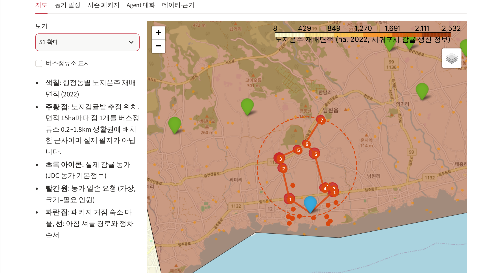
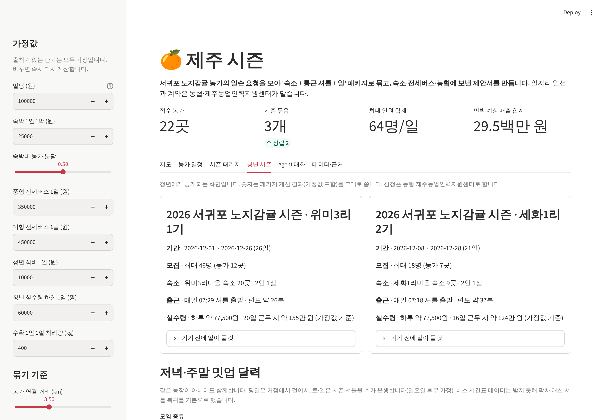

# 제주 시즌 — 서귀포 노지감귤 일손 패키지 Agent

농가가 일손이 필요한 일정을 올리면, Agent가 가까운 농가 일정과 묶어 **숙소 + 통근 셔틀 + 일** 시즌 패키지를 설계하고
숙소·전세버스·농협(제주농업인력지원센터)에 보낼 제안서를 만듭니다. 범위는 **서귀포시 노지감귤 수확**입니다.

기획 배경과 근거: [`../docs/jeju-iju-agent-plan.md`](../docs/jeju-iju-agent-plan.md), [`../docs/jeju-idea-validation.md`](../docs/jeju-idea-validation.md)





## 실행

```bash
cd jeju-season
pip install -r requirements.txt
streamlit run app.py
```

- 키 없이 동작합니다. '시즌 패키지' 탭은 같은 도구를 규칙대로 실행한 결과입니다.
- `ANTHROPIC_API_KEY`를 넣으면 'Agent 대화' 탭에서 Claude(`claude-opus-5-5`)가 같은 도구를 골라 쓰며 대화합니다.
  모델·effort는 `JEJU_SEASON_MODEL`, `JEJU_SEASON_EFFORT`로 바꿀 수 있습니다.
- **인터넷 없이도 지도가 뜹니다.** Leaflet 등 지도 라이브러리는 `static/vendor/`의 로컬 사본을 씁니다(라이선스는 `static/vendor/licenses/`).
  배경 타일(OpenStreetMap)만 인터넷이 필요하며, 오프라인 분석 PC에서는 `JEJU_SEASON_TILES=none streamlit run app.py`로 타일 없이 행정동 경계 위에 그립니다.

데이터를 처음부터 다시 만들려면:

```bash
python scripts/fetch_raw.py            # 공공데이터포털 공개 파일 내려받기 (키 불필요)
python scripts/build_data.py           # 서귀포시 기준으로 가공 → data/processed/
python scripts/make_sample_requests.py # 가상 농가 요청 22건 → data/sample/
```

## Agent 흐름

| 단계 | 도구 (`season/tools.py`) | 판단 |
|---|---|---|
| 1 묶기 | `cluster_requests` | 3.5km 안 + 일정 3일 이상 겹치는 농가를 이음. 평균 12명/일·10일 미만이면 **보류**하고 농가에 조건을 돌려줌 |
| 2 거점 | `find_basecamps` | 반경 7km 안 소규모 숙소를 마을 단위로 모아 수용 인원·거리·정류소·저녁 상권으로 점수 |
| 3 셔틀 | `plan_shuttle` | 좌석을 넘으면 방향별로 차량을 나누고, 최근접+2-opt로 정차 순서·출발 시각 계산 |
| 4 수지 | `check_economics` | 청년 실수령이 하한 미만이면 공개하지 않고 농가 분담·일당 대안 제시 |
| 5 근거 | `offseason_gap` | 카드 매출로 그 동네 숙박업의 수확철/여름 비율 → 제안서 첫 문장 |
| 6 제안 | `write_proposals` | 숙소용·전세버스용·농협용 제안서 |
| 7 청년 | `meetups.plan_meetups`, `season_card` | 평일 저녁 거점 모임(독서회·영화), 토요일 여러 거점이 모이는 공유주방·파티(저녁 상권이 크고 거점들에서 가까운 읍면동), 일요일 가장 가까운 한라산 탐방로. 주말 이동은 시즌 셔틀 추가 운행 |
| 참고 | `harvest_demand`, `charter_candidates` | 생산량에서 월별 수확 인력 규모 추정, 전세버스 업체 후보 |

숫자는 모두 코드가 계산하고, LLM은 도구 선택과 설명·글쓰기만 합니다. Agent는 알선·계약·예약·운행을 하지 않습니다.

## 데이터

[`docs/data-sources.md`](docs/data-sources.md) 참고. 요약:

- **실제 데이터**: 행정동별 노지온주 면적·생산량(2022), JDC 감귤 농가 위치, 마을숙박업소·안전인증민박 위치, 버스정류소·노선, 업종별 카드 매출(2017~2020), 전세버스 업체.
- **추정**: 노지감귤밭 위치. 행정동 면적 15ha마다 점 하나를 버스정류소 생활권에 배치한 근사입니다. 필지 단위 위치는 팜맵 API(인증키 필요)로 대체할 수 있습니다.
- **가상**: 농가 일손 요청 22건.
- **가정값**: 일당, 숙박·버스 단가, 1인 처리량, 수확 시기 비중. 화면에서 바꿀 수 있습니다.

## 테스트

```bash
pip install -r requirements-dev.txt
python -m pytest -q
```

Agent 루프는 가짜 클라이언트로 검증합니다(API 키 불필요). 실제 Claude 호출은 키가 있는 환경에서 확인이 필요합니다.
